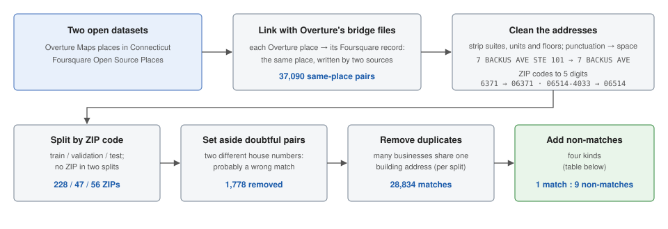
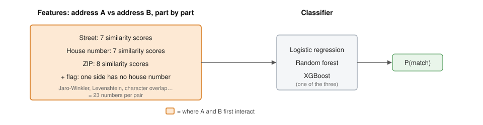

<a href="https://github.com/DZhang3210/address-matching-by-pair-type/blob/main/paper/address-matching-by-pair-type.pdf">Full write-up (PDF)</a> · <a href="https://github.com/DZhang3210/address-matching-by-pair-type">Code</a>

There are many address-matching models, from string-similarity rules to deep learning, but each is evaluated on its own data, so they can't be compared directly. This post runs seven of them on one shared dataset of real address pairs and reports where they differ.

## The data

I used two open datasets, [Overture Maps](https://overturemaps.org/) and [Foursquare Open Source Places](https://opensource.foursquare.com/os-places/). Overture's bridge files link each Overture place to its Foursquare record, which gives pairs of addresses for the same place written by two different sources (Connecticut only).

<figure><figcaption>How the dataset is built. Details of each step are in the <a href="https://github.com/DZhang3210/address-matching-by-pair-type/blob/main/paper/address-matching-by-pair-type.pdf">full write-up</a>.</figcaption></figure>

Then the negatives, the pairs that are *not* the same place. Random pairs are too easy, so I built several kinds, listed below. The two hard pair types are the non-identical matches and the look-alike streets; the models differ only on these. The dataset has a 1:9 ratio of matches to non-matches, and to avoid data leakage, each ZIP code belongs to only one of the train, validation and test splits.

| Pair type | Example | Same place? | Test pairs | Evaluated on |
|---|---|---|---|---|
| Positive, identical | `7 BACKUS AVE` / `7 BACKUS AVE` | yes | 3,543 | yes |
| Positive, non-identical | `12 ELM ST` / `12 ELM STREET` | yes | 843 | yes |
| Different number | `12 ELM ST` / `14 ELM ST` | no | 14,379 | yes |
| Real look-alike street | `100 N MAIN ST` / `100 S MAIN ST` | no | 15 | no (too few) |
| Look-alike street | `431 HALLETT ST` / `431 HARRIET ST` | no | 1,053 | yes |
| Random | two random addresses | no | 24,019 | yes |

| Pair type | How it's built |
|---|---|
| Positive, identical | An Overture place and its linked Foursquare record; the two addresses are identical after cleaning |
| Positive, non-identical | The same link, but the two addresses differ |
| Different number | Two places on the same street in the same ZIP; both addresses have a house number, and the numbers differ. At most 5 partners per place |
| Real look-alike street | Two real places in the same ZIP with the same house number and similar street names (Jaro-Winkler > 0.8), more than 500 m apart |
| Look-alike street | A real address with its street swapped for a different, similar-looking street from the same ZIP; house number kept. Generated because real look-alike pairs are too rare |
| Random | Two random addresses from the same split |

## The models

**Classical models** get the address pre-chopped into pieces: house number, street and ZIP code. For each piece I compute string-similarity scores (Jaro-Winkler, Levenshtein, character-overlap measures and so on), plus a flag for pairs where one side has no house number: 23 features in total. When one side has no number, its house-number features are set to −1, meaning "not comparable". I train logistic regression, a random forest and XGBoost on these features. XGBoost is the tree model used in the comparisons below.

<figure><figcaption>The classical models: 23 similarity features comparing the two addresses part by part, then a classifier.</figcaption></figure>

**Neural models** get only the two raw strings and have to learn the rest:

- a **siamese BiLSTM**, which reads each address character by character, turns it into one vector, and compares the two vectors at the end;
- **ESIM**, which reads word by word (with fastText word vectors) and lets each word of one address attend to the words of the other partway through;
- **DistilBERT as a bi-encoder**, a pretrained transformer used like the siamese model: encode each address separately, compare at the end;
- **DistilBERT as a cross-encoder**, where both addresses go in as *one* input, so every token can attend to every token of the other address from the first layer.

Each neural model is trained with three seeds; the ranges below are the minimum and maximum over the three.

<figure><figcaption>The neural set-ups differ in where the two addresses first meet (orange).</figcaption></figure>

## How I scored them

Each model is scored separately on each pair type: the share of matches it finds, or of non-matches it rejects. Two columns (shaded) matter most:

- **Missing number found**: the share of true matches where one side has no house number (164 pairs, part of the non-identical matches). This is the group where the models differ most.
- **AUC, non-identical vs look-alike**: how well a model tells real but differently written matches from look-alike streets, independent of the threshold.

<table>
<tr><th>Model</th><th>Identical found</th><th>Non-identical found</th><th class="key">Missing number found</th><th>Different number rejected</th><th>Look-alike street rejected</th><th>Random rejected</th><th class="key">AUC, non-identical vs look-alike</th></tr>
<tr><td>Logistic regression</td><td>99.8</td><td>60.1</td><td class="key">76.2</td><td>99.9</td><td>77.7</td><td>100.0</td><td class="key">0.776</td></tr>
<tr><td>Random forest</td><td>100.0</td><td>84.0</td><td class="key">96.3</td><td>100.0</td><td>88.4</td><td>99.9</td><td class="key">0.924</td></tr>
<tr class="hl"><td>XGBoost</td><td>100.0</td><td>83.6</td><td class="key">94.5</td><td>100.0</td><td>87.0</td><td>99.9</td><td class="key">0.920</td></tr>
<tr><td>Siamese BiLSTM</td><td>100</td><td>87.0–89.3</td><td class="key">69.5–75.6</td><td>99.9–100.0</td><td>69.8–73.1</td><td>99.5–99.8</td><td class="key">0.878–0.893</td></tr>
<tr><td>ESIM (fastText)</td><td>100</td><td>87.3–90.3</td><td class="key">71.3–75.6</td><td>98.1–99.0</td><td>73.5–80.4</td><td>99.8–99.9</td><td class="key">0.861–0.890</td></tr>
<tr><td>DistilBERT bi-encoder</td><td>100</td><td>89.0–90.9</td><td class="key">69.5–72.6</td><td>99.8–99.9</td><td>57.6–68.8</td><td>99.8–99.9</td><td class="key">0.883–0.893</td></tr>
<tr class="hl"><td>DistilBERT cross-encoder</td><td>100</td><td>80.3–83.0</td><td class="key">63.4–66.5</td><td>99.9–100</td><td>86.1–88.8</td><td>99.9</td><td class="key">0.888–0.904</td></tr>
</table>

*Test set. Neural models: min–max over three seeds. Highlighted: XGBoost and the DistilBERT cross-encoder.*

## What I found

**1. All models handle the easy pairs.** On identical matches, different-number pairs and random pairs, every model gets about 98–100% right. Overall accuracy would make the models look nearly identical.

**2. Missing house numbers are where the models differ most.** When one side of a true match has no house number (`641 SCOFIELDTOWN RD` / `SCOFIELDTOWN RD`), the neural models find only 63–76% of these matches, about 15 points below their rate on non-identical matches overall. The tree models don't follow this pattern: they find 94–96% of them, more than of non-identical matches overall.

The likely reason is that the tree models get the house number segmented ahead of time: they compare it as its own field, marked "not comparable" when one side has none, which makes this comparison simple. The neural models get no such segmentation; they see only a string with a number missing. The marking matters: with the missing number read as `0` instead, XGBoost finds only 20% of these matches.

{{chart:missing_found}}

**3. On look-alike streets the neural models are level with the trees.** With the missing-number matches set aside, every neural model ranks matches against look-alike streets about as well as XGBoost or better (AUC 0.89–0.94 against 0.91). XGBoost's overall lead comes from the 164 missing-number matches.

{{chart:auc_without_missing}}

**4. The bi- and cross-encoder rank the hard pairs equally; the cross-encoder separates them more cleanly.** Their AUCs overlap (0.883–0.893 and 0.888–0.904); as in the results table, this is the AUC of non-identical matches against look-alike streets, so both rank these two pair types about equally well. The difference is in how their scores are spread. The cross-encoder scores most pairs close to 0 or 1, so almost any threshold works for it. The bi-encoder scores many look-alike streets just below the true matches, so it only separates the two near a threshold of 0.99. At the default 0.5 this makes them look very different: the bi-encoder finds 89–91% of the non-identical matches but rejects only 58–69% of the look-alike streets, while the cross-encoder finds 80–83% and rejects 86–89%.

{{chart:youden_curves}}

**5. Cross-attention brought no clear gain in ranking.** Two pairs of models differ mainly in whether the two addresses attend to each other: the cross-encoder against the bi-encoder, and ESIM against the siamese BiLSTM. In both pairs the AUCs overlap:

| Pair | Without cross-attention | With cross-attention |
|---|---|---|
| DistilBERT | Bi-encoder: 0.883–0.893 | Cross-encoder: 0.888–0.904 |
| BiLSTM | Siamese BiLSTM: 0.878–0.893 | ESIM: 0.861–0.890 |

*AUC of non-identical matches against look-alike streets, test set, min–max over three seeds.*

The DistilBERT pair is the cleaner test, since ESIM also reads words where the siamese model reads characters.

## What I'd do next

- **Give the neural models the house number separately**, or at least a "number missing" signal, like the classical models have. That is where they fall behind.
- **Test it in a retrieval setting**: real geocoding ranks many candidates, not one fixed pair.
- **Go beyond Connecticut.**

Scoring by pair type is what showed this. A single overall number would say the trees beat the transformers; split by pair type, the neural models handle look-alike streets as well as the trees, and the gap is the missing-number pairs.

## Everything is public

- **Paper (PDF):** [address-matching-by-pair-type.pdf](https://github.com/DZhang3210/address-matching-by-pair-type/blob/main/paper/address-matching-by-pair-type.pdf)
- **Code:** [github.com/DZhang3210/address-matching-by-pair-type](https://github.com/DZhang3210/address-matching-by-pair-type), including a notebook that reproduces every table
- **Trained models:** [huggingface.co/zhangdav/address-matching-by-pair-type](https://huggingface.co/zhangdav/address-matching-by-pair-type)
- **Dataset:** [huggingface.co/datasets/zhangdav/address-matching-by-pair-type](https://huggingface.co/datasets/zhangdav/address-matching-by-pair-type)

## Addendum: ESIM and rare house numbers

A detail from building ESIM, not needed for the results above.

**The problem.** ESIM, following the original paper, uses word2vec vectors, which only cover words seen at least twice (`min_count` 2). Every other word becomes one shared "unknown" token. When both house numbers of a same-street pair are seen only once, `2147 SUMMER ST` / `1867 SUMMER ST` becomes `UNK SUMMER ST` / `UNK SUMMER ST`: the same input as the identical match `2147 SUMMER ST` / `2147 SUMMER ST`, with the opposite label. The model can't tell the two apart, so each training run picks one answer for the whole group. All three seeds settled on "non-match", finding at most 22% of the group's identical matches. The group is small, about 0.6% of validation pairs, but telling two house numbers apart is the minimum a matcher should do.

**First attempt: every word gets a vector (`min_count` 1).** This removes the shared unknown token, but it did not fix the problem. word2vec builds a number's vector from the words around it, not from its digits. Two numbers on the same street appear next to the same words, so their vectors end up nearly the same (cosine 0.93, against 0.57 for random pairs of numbers), and the model still can't tell `2147` from `1867`.

**Three more settings**, each changing how a rare number is embedded:

- **fastText** (`min_count` 1) builds each word's vector from its character pieces, so a number's vector comes from its digits.
- **A random vector per rare word**: each word word2vec drops gets its own fixed random vector instead of the shared unknown token. Two different numbers get unrelated vectors.
- **Stacked**: each word's word2vec and fastText vectors side by side.

**Results on the rare-number group.** fastText and the random vector both fix the group: on every seed they find every identical match, reject over 90% of the different-number pairs, and rank the two perfectly (AUC 1.00). Stacking also ranks the group perfectly and finds every match, but rejects only 75–88% of the different-number pairs.

**fastText, the kept setting.** Of the two that fix the group, each is better at one thing. The random vector rejects slightly more of the group's different-number pairs (94–96% against 91–94%), while fastText ranks non-identical matches against look-alike streets better (AUC 0.87–0.90 against 0.85–0.88). The random vector's edge is narrow by design: unrelated vectors are exactly the right signal for two unknown house numbers, but it gives every rare word an unrelated vector, so a rare spelling of a street in a true match also looks like a different street. fastText builds its vectors from character pieces, so it reads the numbers and keeps spelling variants close.

Characters (siamese) and sub-word pieces (DistilBERT) never had this problem.

<table>
<tr><th>Setting</th><th>Rare-number matches found</th><th class="key">Rare-number non-matches rejected</th><th>Rare-number AUC</th><th class="key">AUC, non-identical vs look-alike</th></tr>
<tr><td>word2vec, <code>min_count</code> 2</td><td>1–22%</td><td class="key">95–100%</td><td>0.663–0.720</td><td class="key">0.899–0.909</td></tr>
<tr><td>word2vec, <code>min_count</code> 1</td><td>40–78%</td><td class="key">68–83%</td><td>0.678–0.845</td><td class="key">0.854–0.900</td></tr>
<tr class="hl"><td>fastText</td><td>100%</td><td class="key">91–94%</td><td>1.000</td><td class="key">0.867–0.902</td></tr>
<tr class="hl"><td>Random vector per rare word</td><td>100%</td><td class="key">94–96%</td><td>1.000</td><td class="key">0.847–0.877</td></tr>
<tr><td>Stacked</td><td>100%</td><td class="key">75–88%</td><td>1.000</td><td class="key">0.898–0.916</td></tr>
</table>

*Validation set, min–max over three seeds. Highlighted: the two settings that fix the rare-number group. Shaded: the two columns they trade off on.*
