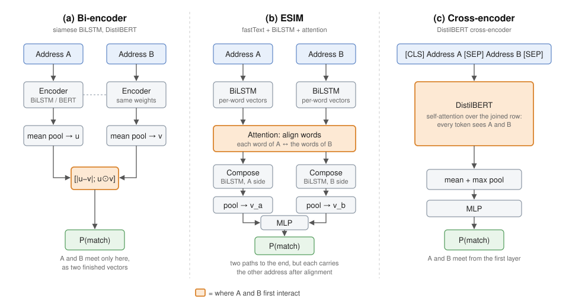

Is <code>12 ELM ST</code> the same place as <code>12 ELM STREET</code>? Obviously. What about <code>431 HALLETT ST</code> and <code>431 HARRIET ST</code>? Probably not, but a model that only looks at how similar the letters are will say yes. And what about <code>74 BEACH RD</code> and <code>BEACH RD</code>?

That last one turned out to be the most interesting question in this whole project.

This post walks through what I built and what I found. The full write-up, with every table, is [the paper (PDF)](https://github.com/DZhang3210/address-matching-by-pair-type/blob/main/paper/address-matching-by-pair-type.pdf), and the code, trained models and dataset are all public (links at the end).

## The problem

Geocoding means turning an address into a point on a map. Somewhere in that process there's a step where you have an address someone typed and a list of candidate addresses from a reference database, usually the ones in the same ZIP code. You have to decide which candidate, if any, is the same place. That final yes/no comparison is **address matching**, and it's what this project is about.

There's a fair amount of work on it, from hand-tuned string-similarity rules to deep learning. Lin et al. (2020), for example, report an F1 of 0.97 with a neural model on Chinese addresses. But I kept running into the same issue when reading these papers: **every paper evaluates on its own data, with one headline number.** You can't compare them, and a single number hides *which* mistakes a model makes. A model can score 98% accuracy while failing badly at the one case you actually care about, because the easy cases swamp the average.

So I set out to put very different kinds of models on the same pairs and score them by the *type* of pair.

## The data

I used two open datasets that describe the same real-world places: [Overture Maps](https://overturemaps.org/) and [Foursquare Open Source Places](https://opensource.foursquare.com/os-places/). Overture publishes "bridge files" that say which Foursquare record each Overture place was matched to. So for every matched place in Connecticut I get two versions of its address, written by two different sources. That's a positive pair, labelled "same place".

A bit of cleaning was needed first. I matched at the **building level**, so suite and floor numbers get stripped (`7 BACKUS AVE STE 101` becomes `7 BACKUS AVE`). That creates lots of duplicates: one mall address appeared 77 times. I kept one copy of each, leaving 28,834 true matches.

Then the negatives, the pairs that are *not* the same place. Random pairs are too easy, so I built several kinds:

| Pair type | Example | Same place? |
|---|---|---|
| Identical match | `7 BACKUS AVE` / `7 BACKUS AVE` | yes |
| Non-identical match | `12 ELM ST` / `12 ELM STREET` | yes |
| Case 1: same street, other number | `12 ELM ST` / `14 ELM ST` | no |
| Case 2s: look-alike street | `431 HALLETT ST` / `431 HARRIET ST` | no |
| Case 3: random | two random addresses | no |

The look-alike streets (case 2s) were the hard part to get. Real examples are rare: only 15 in my whole test set. So I made them: take a real address, keep its house number, and swap in a *different* real street from the same ZIP code whose name looks similar. The non-identical matches and the look-alike streets are the two hard pair types. Every model gets the easy ones right, so they're where the models differ.

Two more design choices mattered. There are nine non-matches for every match, which mimics a model having to reject many wrong candidates. And the train/validation/test split is **by ZIP code**: whole neighbourhoods go to one split, so the test set contains only areas no model has seen.

## The models

I compared two very different approaches.

**Classical models** get the address pre-chopped into pieces: house number, street and ZIP code. For each piece I compute string-similarity scores (Jaro-Winkler, Levenshtein, character-overlap measures and so on), 23 features in total, and train logistic regression, a random forest and XGBoost on them.

**Neural models** get only the two raw strings and have to figure out the rest:

- a **siamese BiLSTM**, which reads each address character by character, squashes it into one vector, and compares the two vectors at the very end;
- **ESIM**, which reads word by word and lets each word of one address "attend" to the words of the other partway through;
- **DistilBERT as a bi-encoder**, a pretrained transformer used like the siamese model: encode each address separately, compare at the end;
- **DistilBERT as a cross-encoder**, where both addresses go in as *one* input, so every token can look at every token of the other address from the first layer.

<figure><figcaption>The neural set-ups differ in where the two addresses first meet (orange).</figcaption></figure>

## How I scored them

Two kinds of numbers:

1. **Per pair type at a 0.5 threshold**: what share of true matches did the model find, and what share of each kind of non-match did it reject?
2. **AUC**, which ignores the threshold. Take a random true (non-identical) match and a random look-alike-street fake. What's the chance the model gives the true match the higher score? 0.5 is a coin flip; 1.0 is perfect.

The second one turned out to be essential. Two models can look very different at 0.5 just because their scores are shifted, while ranking the pairs equally well.

{{chart:auc_overall}}

## What I found

**1. Everyone handles the easy stuff.** Identical matches, a different house number on the same street, random pairs: every model gets about 98–100% of these right. If I'd reported overall accuracy, the models would look nearly identical.

**2. The 0.5 threshold is misleading on its own.** The DistilBERT bi-encoder finds 82–84% of the non-identical matches but rejects only 58–63% of the look-alike streets. The cross-encoder is the opposite: 70–73% found, 82–93% rejected. They look like completely different models. But their ranking ability (AUC) is much closer, and the gap between them has a very specific source.

**3. That source is the house number.** Here's the key chart. It splits the true matches by what happened to the house number, and asks how well each model ranks them above the look-alike fakes:

{{chart:auc_groups}}

- When **both sides have the same house number**, every model except ESIM is around 0.92–0.93. The transformers are just as good as the random forest at telling a typo'd street (`ELM STRET`) from a different street that looks alike.
- When the house number is **missing from one side** (`641 SCOFIELDTOWN RD` / `SCOFIELDTOWN RD`), everything falls apart for the neural models. The random forest still manages 0.85. The cross-encoder drops to about 0.7. The bi-encoder is *at or below chance*: it scores those real matches lower than the fake streets.

So the transformers aren't worse at streets. The tree models' overall lead comes from this one group of 164 pairs. That makes sense: the classical models get the house number as its own field, plus a flag that says "one side has no number". The neural models just see a string with a number missing, and treat that as a big difference.

**4. Part of that group can't be solved at all.** Here's where `74 BEACH RD` / `BEACH RD` comes back. While building the case 1 negatives (same street, different number), I made a mistake: I checked that both places had a house number using their Overture addresses, but the pair actually uses the Foursquare address for one side, which sometimes leaves the number off. So 344 of the test non-matches look exactly like `74 BEACH RD` / `BEACH RD`: two genuinely different businesses on the same road, one without its number.

Those pairs are labelled correctly (they really are different places), but they have the same text pattern as some true matches. No model can tell them apart from the text alone. Every model I scored is close to chance on them (AUC 0.50–0.64). Changing a model's design only moves errors from one side to the other:

{{chart:missing_tradeoff}}

I kept the "sentinel" version: when one side simply lacks a number and everything else agrees, nothing in the text says these are different places, so leaning towards "match" seemed more defensible.

## A detour: ESIM and the invisible house numbers

One fun bug-hunt. ESIM, following the original paper, uses word2vec vectors and drops words seen only once. House numbers are mostly seen once, so they all become the same "unknown" token. That makes `2147 SUMMER ST` / `1867 SUMMER ST` literally identical to the model, with the opposite label to `2147 SUMMER ST` / `2147 SUMMER ST`. Each training run just picked one answer for the whole group. Giving every rare word its own fixed random vector fixed it, because now the model can at least tell "same token" from "different token". Characters (siamese) and sub-word pieces (DistilBERT) never had this problem.

## What I'd do next

- **Give the neural models the house number separately**, or at least a "number missing" signal, like the classical models have. The data says that's exactly where they lose.
- **Fix the case 1 construction** so the ambiguous pairs aren't in the data at all.
- **Test it in a retrieval setting**: real geocoding ranks many candidates, not one fixed pair.
- **Go beyond Connecticut.**

The main lesson for me: **score by the type of mistake.** A single number would have said "trees beat transformers" and stopped there. Splitting by pair type showed the transformers handle streets just as well, and that the whole gap is one specific, fixable thing.

## Everything is public

- **Paper (PDF):** [address-matching-by-pair-type.pdf](https://github.com/DZhang3210/address-matching-by-pair-type/blob/main/paper/address-matching-by-pair-type.pdf)
- **Code:** [github.com/DZhang3210/address-matching-by-pair-type](https://github.com/DZhang3210/address-matching-by-pair-type), including a notebook that reproduces every table
- **Trained models:** [huggingface.co/zhangdav/address-matching-by-pair-type](https://huggingface.co/zhangdav/address-matching-by-pair-type)
- **Dataset:** [huggingface.co/datasets/zhangdav/address-matching-by-pair-type](https://huggingface.co/datasets/zhangdav/address-matching-by-pair-type)
