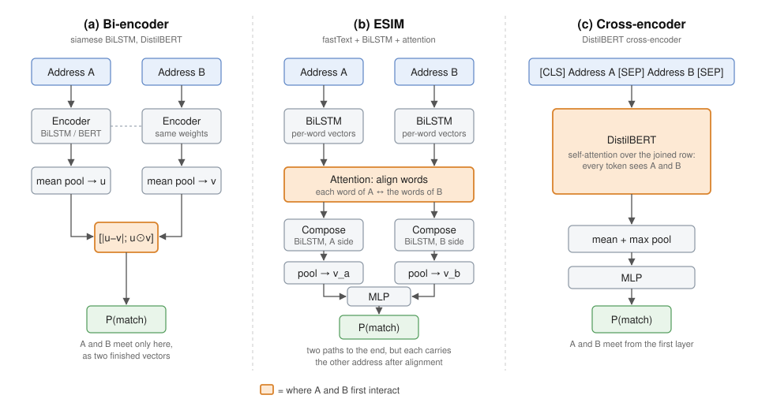

This is the long, informal version of a project I worked on over the last couple of months: comparing classical address-matching models with neural ones, on the same real data, scored by the kind of mistake. It covers how the data was built, every model family, the detours, and what I'd do differently.

The formal write-up is [the paper (PDF)](https://github.com/DZhang3210/address-matching-by-pair-type/blob/main/paper/address-matching-by-pair-type.pdf). This post explains the same work in plainer language, with more of the reasoning behind each choice.

## 1. What address matching is, and why I didn't trust the numbers

When you geocode an address, you're trying to place it on a map by finding it in a reference database. Systems usually do this in two steps. First they narrow the search: only look at addresses in the same ZIP code, say. Then they compare the input with each remaining candidate and decide whether it's a match. That second step, *"are these two strings the same place?"*, is address matching.

It sounds simple until you see real data:

- `12 ELM ST` vs `12 ELM STREET`: same place, different spelling.
- `7 BACKUS AVE STE 101` vs `7 BACKUS AVE`: same building, one mentions the suite.
- `431 HALLETT ST` vs `431 HARRIET ST`: different streets, but the strings are nearly identical.
- `74 BEACH RD` vs `BEACH RD`: no idea.

People have attacked this with string-similarity rules, with parsers that split an address into parts, and with deep learning. Reading the literature, two things bothered me:

1. **Everyone uses their own data.** A neural model reports F1 0.97 on Chinese addresses (Lin et al., 2020); another paper uses synthetic English addresses; nobody shares the pairs. You can't line the numbers up.
2. **Everyone reports one number.** If 90% of your test pairs are obviously different addresses, accuracy is near-perfect for every model, and it tells you nothing about the hard cases.

So the goal became: build one dataset of real address pairs with *labelled kinds of difficulty*, run very different models on the exact same splits, and report how each does on each kind.

## 2. Building the data

### Where the pairs come from

I needed pairs of addresses known to describe the same place but written by different sources, since that's where realistic variation comes from. Two open datasets fit:

- [**Overture Maps Places**](https://docs.overturemaps.org/guides/places): a big open map dataset that merges places from several providers;
- [**Foursquare Open Source Places**](https://opensource.foursquare.com/os-places/): Foursquare's open places database.

Overture publishes **bridge files**, which record which source record each Overture place came from, including Foursquare's. So for each place I can take Overture's version of the address (side A) and Foursquare's version (side B). I limited it to Connecticut to keep it a manageable size: about 193,000 Overture places, giving around 37,000 matched pairs.

One caveat up front: these labels are *Overture's* matching. When I say a model is "right", I mean it agrees with Overture's matcher, which isn't the same as ground truth.

### Cleaning

ZIP codes needed fixing first, because everything later is organised by ZIP. Some had lost their leading zero (`6371` → `06371`), about 30% of Overture's were ZIP+4 (`06514-4033` → `06514`), and a handful were unreadable or out of state (15 rows, dropped).

Then the addresses. I decided to match at the **building level**: two addresses are the same location if they share a street address, even if the suites differ. So I strip unit and floor designators along with their codes (`STE 101`, `UNIT 210`, `2ND FLOOR`, `#4`), replace punctuation with spaces (so `RD,SUITE` doesn't glue together), and leave building numbers and route numbers alone, since `ROUTE 1` and `BLDG 2` *do* change the location.

### Two judgement calls

**Different house numbers.** About 5% of the matched pairs had two different house numbers. That's more likely a wrong match than the same building, so I set those aside.

**Missing house numbers.** About 1,000 pairs had a number on one side only. That looks more like missing detail than a wrong label, so I kept them. Remember this one.

### Duplicates

Stripping suites creates duplicates. A mall has dozens of businesses at one street address; once the suites are gone, they're all the same text pair. `7 BACKUS AVE` / `7 BACKUS AVE` appeared 77 times. To a model that's one example, and keeping all copies would let one building dominate. Keeping one copy per split brought 35,298 positives down to 28,834.

I also split the positives into **identical** (exactly the same string after cleaning) and **non-identical**. The non-identical ones are what actually test a model.

### Splitting by ZIP code

Before generating any negatives, I assigned whole ZIP codes to train, validation or test (70 / 15 / 15% of rows; 228 / 47 / 56 ZIPs). This means no address leaks across splits, neighbours on the same street stay together (needed for the next step), and the test set is made of neighbourhoods no model has seen.

### The negatives

This is the part I spent the most time on. If the non-matches are just random pairs, every model scores ~100% and you learn nothing. So there are several kinds:

| Type | Example | How it's built | Test pairs |
|---|---|---|---|
| Identical match | `7 BACKUS AVE` / `7 BACKUS AVE` | matched pair, strings equal | 3,543 |
| Non-identical match | `12 ELM ST` / `12 ELM STREET` | matched pair, strings differ | 843 |
| Case 1 | `12 ELM ST` / `14 ELM ST` | same ZIP and street, different numbers | 14,448 |
| Case 2 | `100 N MAIN ST` / `100 S MAIN ST` | real places, same number, similar street, > 500 m apart | 15 |
| Case 2s | `431 HALLETT ST` / `431 HARRIET ST` | real address with its street swapped for a look-alike | 1,053 |
| Case 3 | random | two random addresses | 23,942 |

**Case 2** needed a distance rule. Two places with the same number and similar street names close together are almost always the *same* street spelled two ways (about 99% of very similar pairs were within 500 m). Requiring them to be more than 500 m apart fixes that, but leaves only 15 real examples in the test set, far too few.

So I built **case 2s**, a synthetic version: take a real address, keep its house number, and swap in a different real street from the same ZIP whose name looks similar (Jaro-Winkler > 0.8). Swapping within the ZIP keeps the fake plausible for the area. These replace some of the random negatives, so every split stays at one match per nine non-matches, which mimics a matcher having to reject lots of wrong candidates.

## 3. The models

### Classical: features plus a classifier

The classical models follow a *parse-then-compare* pattern. Each address is split into a house number (the leading digits) and a street (the rest). Then each part, house number, street and ZIP, is compared with several string-similarity metrics: Jaro-Winkler, Levenshtein, and overlap measures like Jaccard and cosine on character pairs. That gives 22 features, plus one more, `number_missing`, which flags pairs where exactly one side has no house number. Logistic regression, a random forest and XGBoost are trained on those 23 numbers with default settings.

One design question: what should the house-number features say when one side *has* no number? I tried two options:

- **Sentinel:** set them to −1, outside the normal 0–1 range, meaning "not comparable";
- **Zero-fill:** pretend the missing number is `0` and compare as usual.

### Neural: just the two strings

The neural models get only the raw address strings.

- **Siamese BiLSTM.** Reads each address one character at a time with a bidirectional LSTM, pools the outputs into a single vector per address, then compares the two vectors with `[|u−v|; u⊙v]`. The two addresses only meet at the very end.
- **ESIM.** A word-level model from natural-language inference, previously used for Chinese addresses. It encodes each address word by word, then lets each word of A *attend* to the words of B, before composing and pooling. Word vectors come from word2vec trained on my own addresses.
- **DistilBERT bi-encoder.** A small pretrained transformer, fine-tuned, used like the siamese model: encode each address separately, compare at the end.
- **DistilBERT cross-encoder.** The same transformer, but both addresses go in as one input, `[CLS] A [SEP] B [SEP]`, so every token can look at every token of the other address from the first layer.

<figure><figcaption>The neural set-ups, by where the two addresses first interact (orange).</figcaption></figure>

### Training

All neural models used the same rule for picking the best epoch: it must reject at least 98% of the validation case 1 pairs (same street, different number), and among those, keep the epoch that finds the most non-identical matches. Training stops when that hasn't improved for a few epochs. Each neural model got three random seeds, and I report the range across them. The exception is the siamese model, which got one seed per variant.

Compute was modest: the classical models, the siamese model, ESIM and the cross-encoder ran on my laptop (an M1 Pro), and the bi-encoder on a Colab T4 GPU. An epoch took 3–16 minutes depending on the model.

## 4. How the scoring works

For each pair type I report the share answered correctly at a 0.5 threshold: matches found, or non-matches rejected. I also report **AUC**: take a random non-identical true match and a random look-alike fake. What's the chance the model scores the real one higher? 0.5 means the model can't tell them apart at all.

AUC matters because two models can have very different numbers at 0.5 simply because their scores are shifted, while ranking the pairs equally well. You'll see that happen below.

## 5. Results, family by family

### Classical models

With the sentinel, all three models get nearly every identical match, case 1 and random pair right. On the hard ones, the trees beat logistic regression: about 70% of non-identical matches found vs 50.5%, and about 88% of look-alike streets rejected vs 74%. On case 2s the house number and ZIP match by construction, so the trees must be catching the street difference.

The sentinel vs zero-fill comparison was more interesting than I expected. Zero-fill finds slightly fewer non-identical matches overall (random forest 70.1% → 67.7%), and the whole change comes from pairs where one side has no number:

{{chart:missing_tradeoff}}

Zero-fill turns `74 BEACH RD` / `BEACH RD` into `74 BEACH RD` / `0 BEACH RD`: a different house number, exactly what a case 1 non-match looks like. The sentinel says "not comparable", so the model leans on the street, which agrees. Neither is right on every pair, because, as it turns out, the same text pattern appears with both labels (more on that in section 6).

Looking inside the random forest, about 72% of its feature importance goes to house-number features and 25% to the street. That reflects the training mix: case 1, where only the number differs, makes up a big share of the non-matches.

### Siamese BiLSTM

I tried mean pooling and max pooling. They're close on everything (AUC 0.854 vs 0.835, within what one seed can resolve). Where they differ is, again, pairs with a missing number: max pooling finds more of those matches (46% vs 33%), mean pooling rejects more of the matching case 1 pairs (71% vs 59%). Ranked by AUC, both are close to chance on that group (0.53 and 0.55). They just put the threshold in a different place.

Against XGBoost, the siamese model finds more non-identical matches at 0.5 (80% vs 70%), but rejects fewer look-alike streets (76% vs 89%), and it ranks worse overall (AUC 0.854 vs 0.902).

### ESIM, and the invisible house numbers

ESIM had the best detour. Following the original set-up, word2vec drops words it has seen only once, and the model maps them all to one shared "unknown" vector. House numbers are mostly seen once. So:

| Pair | What ESIM sees | Label |
|---|---|---|
| `2147 SUMMER ST` / `2147 SUMMER ST` | `UNK SUMMER ST` / `UNK SUMMER ST` | match |
| `2147 SUMMER ST` / `1867 SUMMER ST` | `UNK SUMMER ST` / `UNK SUMMER ST` | non-match |

Identical input, opposite labels. Each training run simply picked one answer for the whole group: two seeds rejected most of these case 1 pairs (141 and 158 of 161) but found only 29 and 9 of the 78 identical matches; the third seed did the reverse.

I tried four fixes:

- **Keep every word** (`min_count` 1). Didn't work. word2vec builds a word's vector from the words around it, and two house numbers on the same street have the same neighbours, so their vectors ended up nearly identical (cosine similarity 0.92, vs 0.57 for random pairs of numbers).
- **fastText**, which builds vectors from character pieces, so `4817` and `4819` are similar but not the same. Close: 144–151 of the 161 rejected.
- **A fixed random vector per rare word.** The question here is pure identity (same number or not), and random vectors answer exactly that. 154–158 rejected, every seed, at no measurable cost elsewhere. This is the setting I kept.
- **word2vec and fastText stacked.** Still left same-street numbers too similar.

Even fixed, ESIM didn't beat the simpler siamese model on the pairs that matter (AUC 0.815–0.842 vs 0.854). It differs from the siamese model in two ways at once, though (words instead of characters, plus cross-attention), so I can't say which change cost what.

### DistilBERT: bi-encoder vs cross-encoder

At 0.5 these two look like different species. The bi-encoder finds 82–84% of non-identical matches but rejects only 58–63% of look-alike streets. The cross-encoder finds 70–73% and rejects 82–93%. Their AUCs (0.836–0.845 vs 0.877–0.888) are much closer, and the gap has one source.

## 6. The house number is the whole story

Here's every neural family next to the random forest, with the true matches split by what happened to their house number:

{{chart:auc_groups}}

- **Same number on both sides**, i.e. the look-alike-street question this whole dataset was built around: the transformers are level with the random forest (all about 0.92–0.93). ESIM is a bit behind.
- **Two different numbers** (like `109A` / `109`), only 41 pairs: the transformers are actually *better* than the forest here. Shared sub-word pieces keep the score up, while the forest's number features mark them as different.
- **Number missing on one side**: the forest still scores 0.85. The cross-encoder drops to about 0.7, ESIM to 0.55–0.67, and the bi-encoder is at or below chance (0.45–0.50). It ranks those real matches *below* fake streets.

So the trees' overall lead over the transformers comes almost entirely from 164 pairs with a missing house number. The forest gets the house number as its own field and a flag saying "one side has none", so a missing number doesn't count against the pair. The neural models see a string with a chunk missing and treat it as a big difference. The cross-encoder handles it better than the bi-encoder, probably because reading both addresses together lets it see that the street parts line up.

### And part of it is unsolvable

Now `74 BEACH RD` / `BEACH RD`. When I built case 1 (same street, different number), I checked that both places had a house number, but I checked their *Overture* addresses, while the pair uses the partner's *Foursquare* address, which sometimes drops the number. So 344 of the 14,448 test case 1 pairs have a number on one side only.

They're labelled correctly: they really are two different businesses on the same road. But they look exactly like the true matches where one source left the number off. Nothing in the text can separate them, and every model I scored is close to chance there (AUC 0.50–0.64). That's why every variant comparison above (sentinel vs zero-fill, mean vs max pooling) just traded errors between the two: none of them was actually better.

I didn't rebuild the data to fix this, because it would have meant regenerating the splits and retraining everything. It's documented in the paper and in the dataset card.

## 7. What I'd do differently

- **Check the construction against what the model sees.** The case 1 bug came from checking one field and building the pair from another. A check on the final pairs would have caught it.
- **Report AUC from the start.** For a while I compared models at 0.5 and drew conclusions about which was "better" that were really about where their thresholds sat.
- **Give the neural models the house number separately**, or a "number missing" signal. That's the obvious next experiment, and the data says it's exactly where they lose.

Other limitations: one state, labels from Overture's own matcher, a synthetic look-alike-street set (which includes some genuine spelling variants labelled as different), one small transformer without tuning, and fixed pairs rather than ranking many candidates the way a real geocoder does.

## 8. Everything is public

If you want to use the data or check the numbers:

- **Paper (PDF):** [address-matching-by-pair-type.pdf](https://github.com/DZhang3210/address-matching-by-pair-type/blob/main/paper/address-matching-by-pair-type.pdf)
- **Code:** [github.com/DZhang3210/address-matching-by-pair-type](https://github.com/DZhang3210/address-matching-by-pair-type). The data pipeline, every model, and a notebook that reproduces every table from saved predictions.
- **Trained models (all 23 runs):** [huggingface.co/zhangdav/address-matching-by-pair-type](https://huggingface.co/zhangdav/address-matching-by-pair-type)
- **Dataset:** [huggingface.co/datasets/zhangdav/address-matching-by-pair-type](https://huggingface.co/datasets/zhangdav/address-matching-by-pair-type)

The biggest thing I took away: **score by the type of mistake.** One headline number would have told me "trees beat transformers". Splitting by pair type showed the transformers handle streets just as well, and that the whole gap is one narrow, fixable thing.
